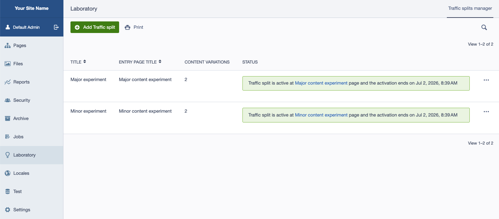
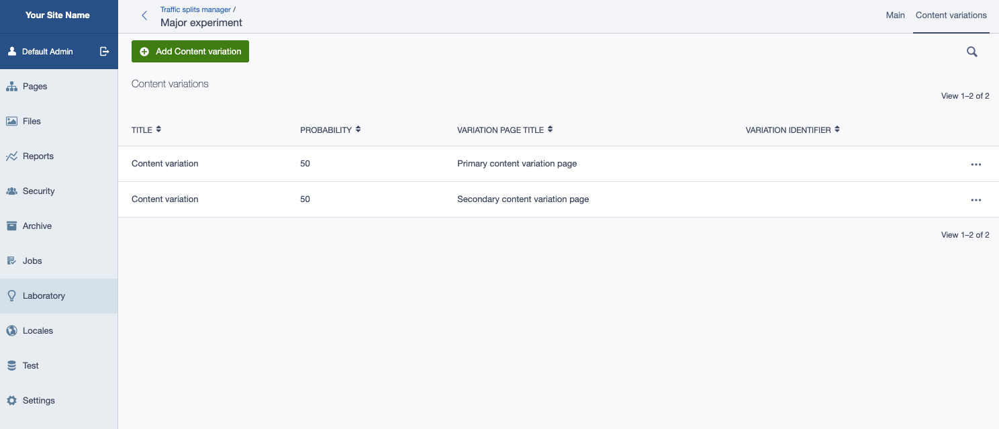
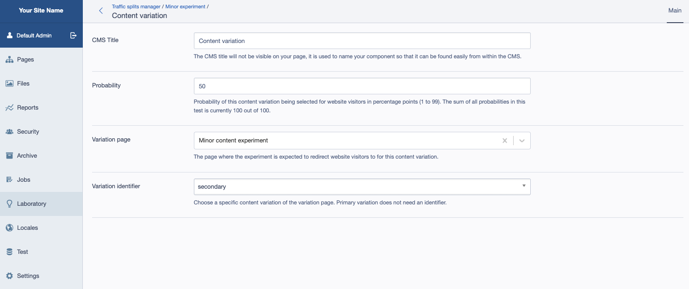
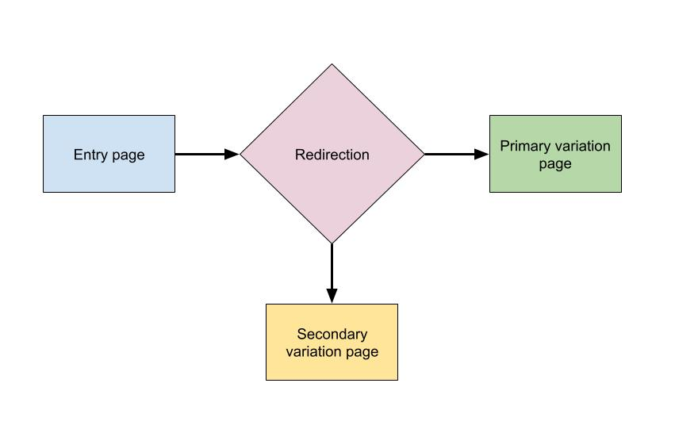
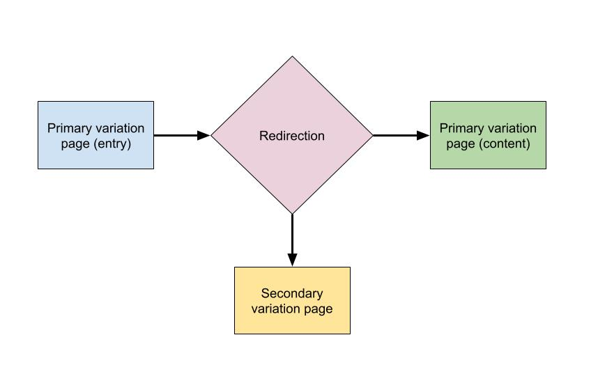
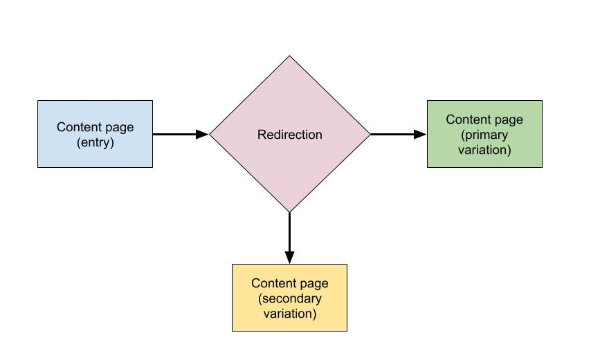
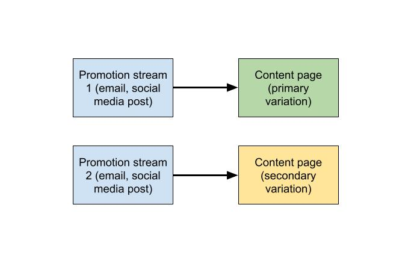
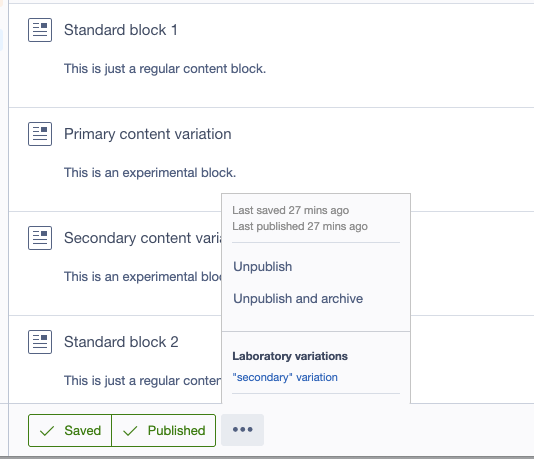

# Silverstripe Laboratory

Make sure that your Silverstripe CMS installation has [`silverstripe/laboratory`](https://github.com/silverstripeltd/silverstripe-laboratory/) installed.

[CHILDREN includeFolders]

## CMS UI for experimentation

Laboratory admin is the place where you manage your experiments.

Content variations represent different user experience that you would like to test.

Individual content variations allow you to choose which page is going to be used to host the content.
Pages that host multiple content variations allow you to choose the "Variation identifier".
This selection can be done only after you have saved your "Variation page" selection.

## Common experimentation setup

Most commons scenarios for content experimentation.

### Different pages hosting content variations with major content difference

This setup is suitable for major differences between content variations.
Each content variation is set up on a different page.
The picture below outlines the related user flow.

It's common to use the primary variation page as the entry page.
This is how such scenario looks like.

### Single page hosting content variations (minor content difference)

This setup is suitable for minor differences between content variations.
All content variations are set up on the same page.
The picture below outlines the related user flow.

Sometimes, a redirect may not be needed. Such scenarios rely on direct link being shared to the target audience by other means such as email or social media post.
This is how such scenario looks like.

Direct link is listed under the "Laboratory variations" section.
Screenshot below shows where to find this widget in the CMS.

